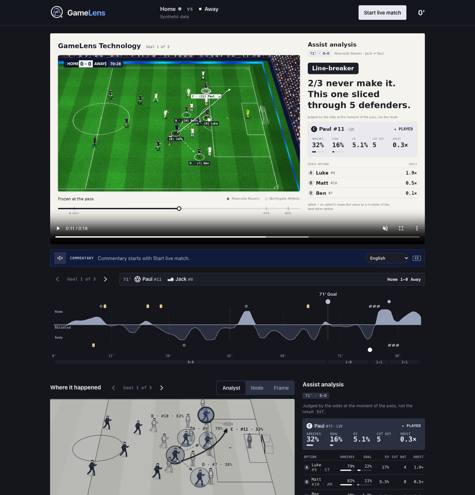

# GameLens

[](https://purple-meadow-07336de00.1.azurestaticapps.net/)

**See why a goal happened.** GameLens turns synthetic football events and tracking into explainable match
intelligence: it replays the killer pass behind every goal, compares it with every other pass the player
could have made, and tells the story like a commentator, in the fan's own language, read aloud, and usable
with a keyboard or a screen reader.

**Live demo:** https://purple-meadow-07336de00.1.azurestaticapps.net/

## The idea

Broadcasts show *what* happened. GameLens explains *why*: at the frame the pass was played, how likely was
it to arrive, how likely to end in a goal, how many defenders did it cut out, and was it the best option on
the pitch?

Two rules keep it trustworthy:

- **Positions come from data, never from a language model.** Player and ball positions come from tracking
  data or computer vision. Models read the scene and word the result; they never place a player.
- **Every number is the formula's.** Verdicts, odds and defender counts come from `engine/assist.py`.
  Anything a model writes is checked against those facts and rejected if it adds, drops or changes one.

**Data:** everything runs on synthetic, football-realistic data: a generated 90-minute match (fictional
teams and players, events plus tracking of every player and the ball) and simulated goal videos. No real
match data or broadcast footage is used, shipped or hosted.

## What works today

| | |
|---|---|
| **Match view** | A 90-minute timeline with momentum and key moments, each goal as a video, then on the pitch in three views: Analyst, Node and Frame. |
| **Pass verdict** | Every teammate scored at the freeze frame: pass arrives, goal chance, expected value, defenders cut out. Verdict: best option, brave pass, line-breaker or smart pass. |
| **Commentary** | Three captions per goal, written from the analysis and spoken by an Azure neural voice. The next goal is prepared while the current one plays. |
| **14 languages** | Each line said the way that language's TV commentators would, never word for word. |
| **Video to analysis** (admin) | `/admin/video`: upload a broadcast-style clip; the vision service tracks players and ball, a scene model reads what tracking cannot, the formulas run on the pass frame, and a person can check that frame before it is published to the match. |

## The AI pipeline

Each step has one job, hands its output to the next, and is checked before anything reaches a fan:

```
tracking / vision ──► formulas ──► commentary writer ──► translator ──► proofreader ──► voice
 (positions)          (numbers)    (from the facts)      gpt-5-mini     gpt-5-mini      Azure Speech
                                                              │   rejected: retry once      │
                                                              └──► Azure Translator ◄────────┘
```

- **Scene reader** (gpt-5-mini on Microsoft Foundry, `vision/scene_llm.py`): reads keyframes for who passed
  or shot, a lofted ball, a pass into space. Code rejects any answer that contains positions.
- **Translator** (gpt-5-mini, `engine/translate.py`): says each caption in the target language's commentary
  style, with a glossary of the pass terms.
- **Checks in code:** every name and number must survive, and the alphabet must be right (Lao is not Thai).
- **Proofreader** (gpt-5-mini): compares the translation with the English and names anything added, missing
  or reversed. The translator retries once with that problem; if it still fails, Azure Translator takes over.
- **Voice** (Azure AI Speech): a native neural voice per language, cached.

## Next: from replays to live

The same pipeline should one day run on a live broadcast-style stream without a person in the loop:

- **Speed:** about 5 s per frame on CPU today; real time needs a GPU and streaming frames.
- **Camera tracking:** keep the camera-to-pitch mapping through pans, zooms, replays and close-ups.
- **Who is who:** read shirt numbers and keep identities across camera cuts.
- **Events:** tune pass and shot detection against a ground-truth set (the admin check already saves one).
- **Live feeds:** licensed event data behind the existing `feeds/` adapter.

Already built towards it: player and ball frames streamed through **Azure Event Hubs** and **Web PubSub**
(`stream/`), and the vision service on **Container Apps** with a serverless GPU option.
See [docs/vision.md](docs/vision.md).

## Run it locally

```bash
python3 -m venv .venv && source .venv/bin/activate
pip install -r requirements.txt
MATCH_SOURCE=proto uvicorn api.main:app --reload   # API on :8000, builds the demo match on first start

cd web && npm install && npm run dev               # web on http://localhost:5173
```

No Azure account is needed: without one, captions use templates and the browser's own voice.
Tests: `pytest -q` and `cd web && npm test`.

## How it is built

```
web/        React + D3: the match page and the admin upload page
api/        FastAPI: match, moments, commentary, speech, admin sign-in
engine/     the formulas (assist.py), moments, momentum, commentary, translation, speech
vision/     separate service: YOLO + ByteTrack, pitch keypoints + homography, events, scene model
highlights/ upload jobs: clip -> vision -> events -> pitch view -> publish
stream/     live replay of events and tracking into Azure Event Hubs and Web PubSub
feeds/      match sources: synthetic (default), the demo match, vision, stubs for licensed live feeds
data_gen/   the synthetic match generator and the demo match
infra/      Bicep for Azure (azd)
```

**Microsoft stack:** Microsoft Foundry (gpt-5-mini: scene reading, translation, proofreading), Azure AI
Speech, Azure AI Translator, Azure Container Apps (API and vision, scale to zero), Azure Static Web Apps,
Azure Event Hubs and Web PubSub, Blob Storage. The services sign in with managed identities, so no keys
are stored; the admin page has its own sign-in with hashed passwords.

## More

- [How it works](docs/how-it-works.md): the formulas, the commentary, translation and voice
- [Vision pipeline](docs/vision.md): from a clip to the freeze frame, accuracy, the road to live
- [Run and deploy](docs/run-and-deploy.md): match sources, the admin page, Azure setup and costs
- [From video to the formulas](docs/vision_formula_plan.md): every input the formulas need and where it comes from
